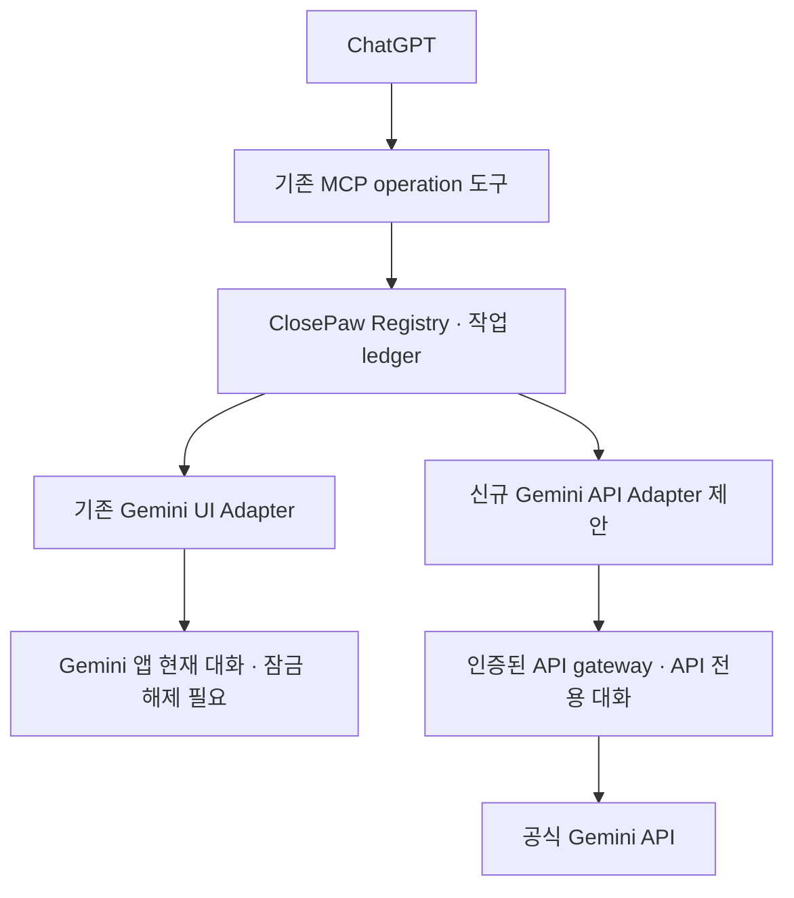

# Gemini 잠금상태 비화면 실행 기술 검토

작성: 2026-10-18 KST. 범위: 기술 조사, 정적 코드 검토, 검증 계획. 구현 변경·APK 빌드·릴리스·실기기 명령 실행은 하지 않았다.

## 1. 의사결정 요약

- **Gemini Android 앱의 기존 대화를 유지하면서, 화면을 켜거나 잠금을 풀지 않고 외부 텍스트 요청과 응답을 주고받는 공개 지원 계약은 확인되지 않았다.** 존재하지 않는다는 전체 APK 분석 결과가 아니라, 아래 공식 문서와 현재 저장소로 확보한 근거의 경계이다. 설치된 Gemini/Google 앱의 전체 exported component와 AppFunctions 목록은 아직 확인하지 않았다.
- **Gemini 공식 API는 비화면 텍스트 왕복이 가능한 공식 경로이다.** Android에서 실행 기회와 네트워크를 확보해야 하므로 잠금 중 항상 즉시 실행된다는 보장은 아니다. Gemini 앱 설치·화면·AccessibilityService는 필요하지 않다.
- **API 대화와 Gemini 앱 대화는 별도로 취급한다.** 조사한 API는 자체 history 또는 API interaction ID를 받으며, Gemini 앱 대화 ID·쿠키·Google 로그인으로 기존 앱 세션을 이어가는 계약을 제공하지 않는다. 같은 계정이어도 앱의 개인화·연결 앱·위치 권한을 자동 승계한다고 설명할 수 없다.
- **Termux의 셸 실행 성공은 Gemini 비화면 제어의 증거가 아니다.** Termux가 제공하는 수신 서비스와 결과 콜백에 대응하는 계약이 Gemini에도 있어야 한다. Termux를 경유해 API를 호출할 수는 있지만 그때 실행되는 것은 Gemini 앱이 아니라 Gemini API이다.
- 권장 결정: 기존 앱 대화가 필수이면 현재 접근성 개발을 유지하고 잠금 요청은 차단한다. API 전용 대화가 허용되면 별도 API Adapter의 개발 검토를 승인할 수 있다. 이번 문서는 개발 착수를 의미하지 않는다.

## 2. 확인한 저장소와 중복 작업

GitHub connector의 branches/pulls 직접 조회와 로컬 전체 clone을 대조했다. 검색 결과 부재를 연결 장애로 해석하지 않았다. 기준 스냅샷은 다음과 같다.

| 대상 | 확인 결과 |
| --- | --- |
| main | `4b2d645949a53a9335e75469aefcbb3eb5e674f8` |
| [PR #94](https://github.com/al-hub/closepaw/pull/94) | Gemini 질문·응답 왕복 병합, main의 기능 commit `74b03398042a3bbe419032525ff636f9ca9e27db` |
| [PR #95](https://github.com/al-hub/closepaw/pull/95) | 열림. `fix/gemini-visible-controls-v0150`, head `e70c2c257af295a5bed4354cd59355239ef66550` |
| #95의 실제 diff | 기준 main 대비 `AndroidGeminiRoundTripUiTest.kt`에 27줄 추가. visible text 전송 라벨, 클릭 가능한 부모, action flag 중복 요구를 재현하는 3개 테스트. PR 제목과 달리 이 head에는 production 수정이 아직 없다. 테스트 통과/수정 완료로 간주하지 않는다. |
| 기타 관련 branch | `security/gemini-roundtrip`=`117e6b18b2b7454791e76161325c5fb34b17ec0b`, `fix/gemini-hosted-read-v0148`=`18828aee8577a1de6118ebbcc24c1ddb2fdca315`, `docs/gemini-roundtrip-plan-20261017`=`47c81190ef1916108dcb1dd0b341178ac89e2910` |

전체 branch 목록에서 Gemini 관련 ref를 확인했으며, 상세 구현 비교는 main과 최신 열린 #95를 대상으로 했다. 위 SHA 이후 다른 작업자가 변경할 수 있으므로 실제 개발 착수 시 재확인한다. 기존 전달 기록은 [v0.1.49 문서](gemini-roundtrip-v0149.md)에 있고 실기기 수락은 PENDING이다. 과거 [실행 방식 비교](termux-vs-gemini-execution.md)는 v0.1.48 기준이므로 그 문서의 ‘왕복 미구현’을 최신 main 상태로 오독하지 않는다.

## 3. 현재 코드 경로와 제약

아래 경로는 저장소 루트 기준이며 위 main SHA에서 확인했다. [고정 소스 트리](https://github.com/al-hub/closepaw/tree/4b2d645949a53a9335e75469aefcbb3eb5e674f8/app/src/main/kotlin/ai/closepaw)를 기준으로 읽는다.

| 책임 | 코드 근거 | 확인된 동작 |
| --- | --- | --- |
| MCP 계약 | `chatgpt/McpOperationTools.kt`, `AndroidOperationRuntime.kt` | `discover_operations`, `query`, `execute`, `get_task`, `cancel_task`. 앱별 기능은 registry에 등록. |
| 작업·재시작 | `chatgpt/operations/OperationDispatcher.kt`, `OperationTaskStore.kt` | request ID와 입력 fingerprint 중복 방지, 결과 paging. 재시작 시 진행 중 작업을 `outcome_unknown`으로 전환하며 자동 재전송하지 않는다. |
| Gemini 조율 | `chatgpt/GeminiRoundTripOperation.kt` | `gemini.question.ask`, 별도 로컬 질문 전송 허용. 입력 text 최대 8,000자, timeout 1~120초(기본 60초), conversation=`current`만 허용. |
| 실행·입력 | `chatgpt/AndroidGeminiDraftUi.kt`, `platform/AccessibilityPlatform.kt` | launcher Intent로 앱 실행 후 Gemini 전면 창 확인. `ACTION_SET_TEXT`로 빈 입력창만 수정하고 재확인. 패키지뿐 아니라 Google-hosted Gemini 창 증거도 검사한다. |
| 잠금 차단 | `AndroidGeminiDraftUi.isLocked()`, `GeminiQuestionSubmitter.kt` | `isKeyguardLocked || !isInteractive`면 실행/입력/전송 차단. 잠금 해제 상태에서 화면만 꺼져도 차단한다. |
| 전송 | `GeminiQuestionSubmitter.kt`, `AndroidGeminiRoundTripUi.kt` | 대상·입력·전송 후보 유일성 재검사 → durable `submitting` 기록 → 의미 기반 `ACTION_CLICK` 한 번. 클릭 성공과 실제 질문 전송 관찰을 구분한다. |
| 응답 | `GeminiReplyCollector.kt` | 새 질문과 새 답변 상관관계, 완료 증거와 1초 안정성 확인. 500ms 간격 관찰, 답변 최대 16,000자. 잠금/대상 변경/허용 해제 시 중단하며 일부 결과와 불확실성을 보존한다. 왕복 수집은 접근성 tree 기반이며 OCR로 완료를 대신 입증하지 않는다. |
| 일반 화면 읽기 | `chatgpt/GeminiScreenReadPolicy.kt`, `ReadAppTool.kt` | 가시 화면 읽기와 왕복 완료 판정은 별도. 일반 읽기의 OCR/캡처 가능성이 백그라운드 응답 API를 의미하지 않는다. |
| Termux 직접 계약 | `termux/TermuxRunCommandAdapter.kt`, `bridge/TermuxRunCommandExecutionAdapter.kt` | 명시적 `com.termux.app.RunCommandService`, `com.termux.RUN_COMMAND`, background extra와 mutable PendingIntent 결과 callback. stdout/stderr/exitCode 수신 및 timeout/권한/시작 제한 분류. 제공 capability는 `LINUX_SHELL`이다. |
| 실제 MCP 셸 경로 | `AndroidOperationRuntime.kt`, `TermuxShellOperation.kt`, `bridge/TermuxJobClient.kt`, `TermuxLocalBridgeExecutionAdapter.kt` | `linux.shell.exec`는 paired Local Bridge의 durable job을 사용한다. 모든 셸 요청이 매번 RUN_COMMAND로 실행되는 구조가 아니다. RUN_COMMAND는 지원 설치본에서 별도 실행/부트스트랩 수단이다. |
| 부팅·서비스 | `app/src/main/AndroidManifest.xml`, `chatgpt/ChatGptConnectionReceiver.kt` | targetSdk=36. MCP 서비스는 `specialUse` FGS, `BOOT_COMPLETED`/업데이트 시 복구 경로가 있다. receiver에 directBootAware/LOCKED_BOOT_COMPLETED가 없고 credential encrypted 설정을 사용한다. 재부팅 후 첫 잠금 해제 전 지원으로 간주하지 않는다. |

기존 operation ledger, 결과 paging, 로컬 허용, diagnostics의 본문 비기록 원칙을 재사용할 수 있다. 반면 앱의 UI 세션을 API session으로 변환하는 기능은 현재 없으며 새 구현에서도 자동 동기화를 전제하면 안 된다.

## 4. 공식 지원과 실험 경계

### 4.1 Gemini 앱의 Intent·Service·Provider

Android Intent는 수신 앱이 공개한 component/계약을 호출하는 전달 수단이다[S3]. `ACTION_SEND`의 텍스트 공유, `ACTION_PROCESS_TEXT`, launcher, assist, deep link는 설치본의 handler가 있을 때 UI 진입 후보일 수 있다. **자동 생성 시작·대화 지정·결과 callback까지 지원한다는 뜻은 아니다.** 구체적인 Gemini action/extra/응답 계약을 공식 문서에서 확인하지 못했으므로 임의의 private action이나 component 이름을 제품 기능으로 채택하지 않는다.

공개 prompt/response Service 또는 ContentProvider 계약도 미확인이다. exported component가 발견되더라도 접근 권한·문서화된 입력·결과 형식·호환성 보장·잠금 동작을 추가로 입증해야 한다. Gemini APK/Google 호스트 manifest를 이 환경에서 획득·검사하지 않았으므로 ‘exported Service가 하나도 없다’고 단정하지 않는다.

### 4.2 Termux RUN_COMMAND와 Android 전달 구성요소

Termux는 실제 수신 서비스, RUN_COMMAND 권한, `allow-external-apps`, 실행 인자와 결과 PendingIntent를 문서화한다[S1,S2]. ClosePaw도 이 계약을 구현한다. 모든 Termux 배포판에서 동일한 서비스가 제공되는지는 capability probe로 판단한다.

| Android 구성요소 | 가능한 역할 | Gemini 제약을 해결하지 못하는 이유 |
| --- | --- | --- |
| Intent | 공개 Activity/Service/Receiver 호출 | 수신자가 지원하지 않는 prompt/response 동작을 만들지 못함 |
| PendingIntent | 수신자가 나중에 호출할 제한된 토큰·결과 전달 | Gemini가 callback을 받거나 호출하는 계약이 확인되어야 함 |
| BroadcastReceiver | 공개 broadcast 수신 또는 우리 callback 수신 | Gemini 내부 생성기·대화 DB 접근 권한을 부여하지 않음 |
| ForegroundService | ClosePaw 연결·HTTP 작업을 적법한 실행 조건에서 유지 | 다른 앱의 private 기능을 노출하지 않으며 Activity 실행/잠금 제한도 별개 |

Termux에서 `am`을 실행하더라도 일반 앱 UID·exported/permission 제한을 받는다. Termux 프로세스는 ADB shell이나 root가 아니다. UI `input` 주입·private binder·앱 데이터 읽기·쿠키 추출·숨은 API 탐색을 대안으로 추진하지 않는다. 셸 종료 코드 0은 Gemini가 답을 생성하고 회수했다는 증거가 아니다.

### 4.3 AppFunctions

AppFunctions는 Android 16(API 36) 이상에서 앱이 기능을 노출하고 허용된 caller가 실행하는 플랫폼/Jetpack 경로이다[S4,S5]. 공식 개요는 실험적 preview이며 Gemini 통합은 trusted tester private preview라고 설명한다. 핵심 방향은 **Gemini → 다른 앱이 노출한 함수**이며, **ClosePaw → Gemini 생성 함수**가 있다는 증거가 아니다.

`EXECUTE_APP_FUNCTIONS`는 현재 reference상 normal permission이지만 runtime allowlist 검사와 추가 조건이 있다[S6]. manifest 선언만으로 호출 가능하다고 가정하거나 signature-only라고 단정하지 않는다. 실기기 OS/QPR/Jetpack 버전, target 함수 등록·enabled 상태, caller 허용을 모두 확인해야 한다. 최신 reference의 API 37+ 기능을 API 36 기기에 소급 적용하지 않는다. Gemini가 공개한 질문·응답 함수가 확인되기 전에는 개발 경로에서 보류한다.

### 4.4 공식 잠금화면 Gemini와 공식 API

Google은 사용자가 터치/Hey Google로 잠금 중 일반 질문 등을 할 수 있다고 안내하며 일부 개인 정보 작업에는 잠금 해제를 요구한다[S7]. 이는 실제 공식 잠금화면 기능이다. 그러나 외부 앱의 임의 텍스트 주입·무화면 자동 응답 회수 계약을 문서화하지 않는다. 음성 재생으로 Hey Google를 유도하는 방법도 이번 목표의 구조화 텍스트/응답 경로로 채택하지 않는다.

Gemini API는 HTTP/SDK로 텍스트 생성과 응답 수신을 제공한다[S8,S9]. history를 직접 유지하거나 Interactions API의 `previous_interaction_id`로 API 내 대화를 연결할 수 있다. 후자는 자체 보관·상태 정책을 검토해야 하며 Gemini 앱 대화 ID와 같지 않다. API 서버 측 background 실행 옵션과 Android 앱의 background 생존은 서로 다른 개념이다. 이 검토에서는 일반 텍스트 API 호출만으로도 비화면 가능성을 인정하며 특정 beta 기능에 의존하지 않는다.

Gemini 앱의 기존 대화·메모리·연결 앱·휴대폰 위치를 API로 그대로 조회/수정하는 공식 동기화 경로는 확인되지 않았다. 사용자 동의로 일부 텍스트를 API history에 제공하는 것은 문맥 복사일 뿐 동일 앱 세션 유지가 아니다. 정확한 위치 같은 기능은 별도 권한·위치 도구가 필요하다.

## 5. A~D 비교

‘조건부 가능’은 공식 primitive로 설계 가능한 상태이며 이 프로젝트의 구현/실기기 통과를 뜻하지 않는다.

| 방식 | 화면 꺼짐·잠금 실행 | 텍스트 전달/응답 회수 | Gemini 앱 기존 대화 | 보안 제약 | 유지보수·비용 | 판정 |
| --- | --- | --- | --- | --- | --- | --- |
| A. Gemini 앱 공식 Intent/Service 직접 호출 | 외부 자동화 경로 미확인 | 공개 양방향 계약 미확인. 앱 열기/공유만으로 불충분 | 지정·유지 계약 미확인 | exported·권한·BAL·잠금 정책 | 공개 계약 발견 시 평가. 현재 비용 절감도 보장 못함 | 현시점 채택 불가, 문서화된 계약 발견 시 재평가 |
| B. Termux RUN_COMMAND → Android 명령 | 셸 자체는 조건부 가능 | Termux 출력은 회수 가능. Gemini 생성 응답은 별도 계약 필요 | 보장 불가 | 일반 앱 UID, Termux 권한·외부 앱 허용·FGS | 추가 프로세스·복구 의존. API 호출 시 API 비용 동일 | Gemini 앱 잠금 해법으로 제외 |
| C. 공식 Gemini API | 조건부 가능, 화면/앱 UI 불필요 | 공식 요청/응답 제공 | 자동 유지 불가. API 전용 대화 유지 가능 | API 인증·TLS·명시적 사용 동의·예산·데이터 보관 | UI 변화 영향 적음. 무료 tier 제한/유료 사용료 및 proxy 운영 가능성[S10,S11] | 비화면이 우선이고 별도 대화 허용 시 권장 |
| D. 접근성 + API 하이브리드 | API 경로만 조건부 가능, 접근성 경로는 차단 | UI와 API 각각 독립 검증 | UI에서는 현재 앱 대화, API에서는 별도 대화 | provider 선택·전송 동의 분리, 조용한 fallback 금지 | 두 경로 관리 비용. API 사용 시 별도 비용 | 장기 권장 구조, ‘동일 세션 비화면’ 해법은 아님 |

앱 구독이 API 무료 호출권을 제공한다고 전제하지 않는다. 요금·모델을 고정하지 않고 개발 결정 시 공식 pricing과 사용량 제한을 다시 확인한다[S10].

## 6. Android 16·Galaxy 실행 조건

1. **잠금과 실행 중지는 다르다.** 첫 잠금 해제 후 다시 잠근 상태에서는 credential encrypted 저장소가 계속 접근 가능하지만 Doze·네트워크·프로세스 생존 제약은 남는다[S12,S13]. API는 잠금 그 자체로 금지되는 UI 작업이 아니지만 항상 즉시 실행되는 것은 아니다.
2. **FGS 시작과 유지 구분.** Android 12+ 백그라운드 FGS 시작은 예외가 필요하며 교차 앱 시작에도 각 앱의 target과 상태가 관여한다. 원격 요청이 왔다는 사실만으로 예외를 가정하지 않는다. while-in-use 카메라·마이크·위치와 부팅 시 일부 FGS type 제한도 별도로 적용된다[S14]. 현재 specialUse 선언을 무제한 실행 허가로 해석하지 않는다.
3. **Activity 실행은 별도 제한.** foreground service가 존재해도 background Activity launch는 별도 정책을 받는다. PendingIntent sender/creator opt-in도 별도이다[S15]. 이것을 완화해도 화면을 띄우는 방식은 무화면 목표를 충족하지 않는다.
4. **Android 16 job quota.** FGS와 함께 도는 JobScheduler/WorkManager 작업도 quota 영향을 받는다. WorkManager에 옮기는 것만으로 즉시 응답·상시 실행이 보장되지 않는다[S16].
5. **Galaxy 절전.** sleeping/deep sleeping 설정은 background 작업에 영향을 준다. 필요한 앱의 예외는 사용자가 설정해야 하며 ClosePaw가 몰래 변경하지 않는다. One UI·Google 앱 버전별로 실제 동작을 기록한다[S17].
6. **재부팅과 강제 종료.** 재부팅 직후 첫 unlock 전에는 현재 ClosePaw의 연결 복구·credential 설정 사용을 기대하지 않는다[S12 및 코드]. 첫 unlock 후 BOOT_COMPLETED 복구는 별도 실기기 검증 대상이다. 기존 Stop 의도를 존중하며 force-stop/서비스 종료 뒤 무조건 자동 복구한다고 약속하지 않는다.

## 7. 권장 아키텍처와 영향 범위 — 제안만, 미구현

기존 `gemini.question.ask`의 current-app-conversation 의미와 잠금 차단을 유지한다. 새 기능은 예를 들어 `gemini.api.question.ask`라는 별도 operation으로 등록해 API 전용 대화임을 discovery 설명과 결과에 명시한다. 이 ID는 제안이며 현재 사용 가능 기능이 아니다.

두 경로의 결과는 기존 task/get_task를 통해 반환한다. API gateway는 신규 제안이며 기존 ClosePaw control-plane이 이미 그 역할을 한다는 뜻이 아니다. 제품 배포에서 API key를 APK에 하드코딩하지 않는 서버 proxy를 우선 검토한다[S11]. 모바일 공식 SDK를 선택하면 지원되는 Firebase AI Logic 인증/보호 구성을 따로 설계해야 한다.

| 책임/SRP | 재사용 또는 신규 범위 |
| --- | --- |
| 인증·비용 허용 | 별도 기본-off API 허용, 서버 측 credential·사용량 한도·요청 인증. 기존 draft/send 허용과 분리 |
| API transport | HTTP/SDK 호출·오류 매핑·응답 제한·timeout. screenMutex/AccessibilityService 불필요 |
| 대화 저장소 | API session ID와 history 관리, 동일 대화 동시 요청 직렬화, provider 표시·보관/삭제 정책 |
| 실행 조율 | 기존 registry/dispatcher/task store와 request dedup 재사용. API 접수 후 결과 불명 시 자동 재전송 금지 |
| 복구·결과 | 결과에 provider, API 대화 식별자, completion/partial/unknown 표시. 앱 세션 ID라고 표시하지 않음 |
| MCP·다른 앱 | 고정 5개 operation 도구 envelope 유지. 내부 operation 추가와 runtime schema discovery로 확장. 서버의 앱 allowlist 하드코딩을 추가하지 않음 |

현재 전송 허용의 operationAllowed 분기·settings·registry에는 API operation 등록이 추가로 필요하다. 따라서 ‘MCP 스키마 유지 가능’은 ‘코드 변경이 전혀 필요 없음’을 뜻하지 않는다. API 관련 변경은 별도 branch/PR에서 진행하고 #95의 UI selector·reply 검증 수정을 재작성하지 않는다. API 실패를 UI로, UI 잠금 실패를 유료 API로 자동 전환하지 않는다.

## 8. 검증 계획과 합격 기준

**아래 항목은 모두 계획이며 실기기 미수행이다.** 이번 작업에서는 새 APK·API 키·과금 요청·장치 제어를 만들지 않았다. 현재 앱 UI 동작은 기존 #94/#95의 검증 작업에서 수행하며 이 문서가 수락을 대체하지 않는다.

### 8.1 우선순위와 중단 조건

- A/AppFunctions는 먼저 문서화된 함수·입력/응답·호출 권한을 확보한다. 공개 query로 handler 또는 function metadata를 한 번 확인할 수 있으나, 없거나 permission denied면 기록 후 중단한다. 추측 action/extra를 바꿔가며 반복 호출하지 않는다.
- 실기기에서 `com.google.android.apps.bard`와 Google 호스트 `com.google.android.googlequicksearchbox`의 실제 버전, exported component/permission과 function 등록을 읽기 전용으로 확인한다. ADB를 쓰면 사용자가 허용한 진단 세션에서만 수행한다. ADB UID의 성공은 일반 ClosePaw UID 성공으로 인정하지 않는다.
- B는 기존 Termux 진단의 무해한 고정 출력으로 ‘셸 실행’만 확인한다. Gemini 왕복의 성공 증거로 쓰지 않는다. A 계약이 없다면 B→Gemini 잠금 호출 실험을 진행하지 않는다.
- C는 개발 승인·인증/비용 구성 후에만 시험한다. 일반 비개인 텍스트로 독립 API 대화를 만들고 로컬/서버 ledger를 함께 대조한다.

### 8.2 상태별 실기기 매트릭스

| 시나리오 | 기존 접근성/UI 예상 | API Adapter 구현 후 기대/측정 |
| --- | --- | --- |
| 1. 화면 켜짐·잠금 해제 | #95 보완 후 한 질문·새 응답 검증, 현재 대화 유지 | UI 변화 없이 한 요청/응답, provider=API |
| 2. 화면 꺼짐·보안 잠금 | `device_locked` 또는 중간 잠금 중단. 전송·화면 깨움 없어야 함 | 첫 unlock 이후 조건에서 실행/결과 수신. 전후 `isInteractive=false`, keyguard locked 유지와 수동 화면 관찰로 검증 |
| 3. Gemini 앱 미실행 | 잠금 해제 때 launcher 실행·대상 검증 | Gemini/Google 앱을 실행하지 않고 성공 |
| 4. Gemini 앱 background | 잠금 해제 때 foreground로 이동 후 검증 | API 대화만 변경, 앱 대화·foreground 영향 없음 |
| 5. ClosePaw Activity background | 연결 서비스가 살아 있는지와 UI 실행 제한을 구분 | FGS warm 상태와 process cold 상태를 분리. cold 시작 거부는 명확한 not-ready/복구 안내 |
| 6. 텍스트 왕복·대화 지속 | 질문 일치·새 답변·완료 증거. 긴 결과는 partial 명시 | 2회 대화로 API history 연속성, 앱 history 비동기화 확인. Unicode·출력 상한·paging 검증 |
| 7. 실패·timeout·재접속 | 전송 직전/직후 잠금·창 전환, 취소 시 observation만 중지 | 401/403/429/5xx·무응답·네트워크 단절·응답 중 종료. 요청 접수 여부 불명 시 unknown, 중복 과금/전송 방지 |
| 8a. reboot 후 첫 unlock 전 | 현재 미지원, 연결 준비 불가를 명시 | 현재 복구 구조상 미지원으로 시작. 별도 Direct Boot 설계 없이는 성공 조건으로 두지 않음 |
| 8b. reboot → 첫 unlock → 다시 잠금 | 연결 복구 후 UI 요청은 계속 잠금 차단 | 자동 연결 복구·API session 회복·불명 작업 무재전송. Stop 상태이면 미연결 유지 |
| 9. Doze·절전·Wi-Fi/모바일 전환 | 연결 장애와 UI 장애를 구분 | 장시간 화면 꺼짐 후 지연/timeout 측정. Doze·절전 예외 유무·deep sleep 설정 각각 기록 |
| 10. 강제 종료·권한 철회 | 자동 제어 중단과 불확실 결과 명시 | 영구 장애 busy-loop 없이 not-ready. 사용자 재시작/허용 복구 뒤 ledger 안전성 확인 |

초기 기능 검증은 상태별 서로 다른 request ID로 3회, 같은 request ID 재조회는 추가 전송 0회가 기준이다. 전체 기기 인증 수치가 아니라 제안된 최소 반복 기준이다. 한 번 성공으로 상시 실행/모든 Galaxy 지원을 선언하지 않는다.

실기기 기록 항목: 기종, Android/One UI/QPR, Gemini 및 Google 앱·ClosePaw 버전, 설치 출처, FGS/연결 상태, 잠금·화면·절전 설정, 요청/작업 상관 ID, 단계·소요시간·오류·완료 상태, 실제 전송 횟수. 공개 문서에는 질문·응답 원문·위치·API key·토큰·개인 연결 주소를 남기지 않는다. 기존 앱 대화로 진행할 UI 질문은 사용자가 지정한 비개인 내용만 사용한다.

### 8.3 TDD 계획

이번 문서 변경은 실행 코드를 바꾸지 않으므로 새 테스트나 Android 빌드를 수행하지 않는다. 향후 개발에서는 실패 테스트부터 작성한다.

1. Fake API transport로 요청/응답 매핑, 오류·timeout·출력 상한·취소 의미·permission-off 차단을 확인한다.
2. 동일 request ID 및 병렬 요청 중복 방지, session별 순서, 전송 후 process 종료/복구 시 unknown 처리와 자동 재전송 금지를 검증한다. 공급자 idempotency 지원이 입증되기 전에는 exactly-once를 약속하지 않는다.
3. API key/본문 로그 비노출, API 허용과 UI 허용 독립, 잠금 요청이 UI로 fallback하지 않는 테스트를 추가한다.
4. 기존 GeminiDraft/QuestionSubmitter/ReplyCollector/RoundTrip/TaskStore 회귀 테스트를 유지한다. #95 테스트와 production 수정은 해당 작업의 소유 범위로 둔다.
5. mock 통과 후 위 Galaxy 매트릭스를 실제 기기로 수행한다. ADB-only 성과와 일반 앱 권한 성과, API 서비스 성공과 ChatGPT까지 결과 반환 성공을 분리 기록한다.

## 9. 개발 착수 판단

| 요구 | 현시점 판단 |
| --- | --- |
| 기존 Gemini 앱 대화를 그대로 사용 + 무화면 잠금 왕복 | 공식 지원 경로 미확인. 구현 착수 보류 |
| API 전용 대화 허용 + 무화면 잠금 왕복 | 기술적으로 실현 가능한 공식 경로 확인. 인증·비용·백그라운드 생존 설계 후 별도 개발 가능 |
| 기존 접근성 기능 유지 | 가능. 현재 #95 진행과 충돌 없이 보존 |
| 플러그인 재등록 없는 앱 내부 확장 | 기존 operation discovery 구조를 재사용 가능. 새 API operation의 명시적 등록·허용 처리는 필요 |

## 10. 공식 자료

각 URL은 2026-10-18 KST 조사 시 확인했다. 플랫폼 reference는 더 최신 API도 함께 표시하므로 API 36 적용 여부를 구분한다. ‘미확인’ 판정은 검색 0건만이 아니라 아래 계약/권한/입력·응답 문서와 현 코드 경로를 종합한 판단이다.

- [S1 Termux RUN_COMMAND 공식 프로젝트 wiki](https://github.com/termux/termux-app/wiki/RUN_COMMAND-Intent)
- [S2 Termux RunCommandService 실제 구현](https://github.com/termux/termux-app/blob/master/app/src/main/java/com/termux/app/RunCommandService.java)
- [S3 Android Intents and intent filters](https://developer.android.com/guide/components/intents-filters)
- [S4 AppFunctions overview](https://developer.android.com/ai/appfunctions)
- [S5 AppFunctionManager reference](https://developer.android.com/reference/android/app/appfunctions/AppFunctionManager)
- [S6 EXECUTE_APP_FUNCTIONS permission](https://developer.android.com/reference/android/Manifest.permission#EXECUTE_APP_FUNCTIONS)
- [S7 Gemini 잠금화면 공식 도움말](https://support.google.com/gemini/answer/14576209?hl=en)
- [S8 Gemini API text generation](https://ai.google.dev/gemini-api/docs/text-generation/)
- [S9 Interactions API: API 내 history 연결](https://ai.google.dev/gemini-api/docs/interactions-overview)
- [S10 Gemini API pricing](https://ai.google.dev/gemini-api/docs/pricing)
- [S11 API key 보안 지침](https://ai.google.dev/gemini-api/docs/api-key)
- [S12 Android Direct Boot](https://developer.android.com/privacy-and-security/direct-boot)
- [S13 Doze and App Standby](https://developer.android.com/training/monitoring-device-state/doze-standby)
- [S14 FGS background start restrictions](https://developer.android.com/develop/background-work/services/fgs/restrictions-bg-start)
- [S15 Background Activity launch security](https://developer.android.com/guide/components/activities/secure-bal)
- [S16 Android 16 all-app behavior changes](https://developer.android.com/about/versions/16/behavior-changes-all)
- [S17 Samsung Application Management](https://developer.samsung.com/mobile/app-management.html)

## 11. 이번 작업의 검증 범위

최신 main/branch/PR 메타데이터 조회, main 및 #95의 실제 diff·위 코드 정적 검토, 공식 문서 대조를 수행했다. 문서는 별도 docs branch에만 commit/push한다. 코드·권한·MCP 스키마·Gradle 버전·workflow·태그를 변경하지 않고 릴리스 workflow도 dispatch하지 않는다. 실기기/API 실행 성공, 잠금상태 E2E 완료 또는 기존 #95 해결로 보고하지 않는다.
