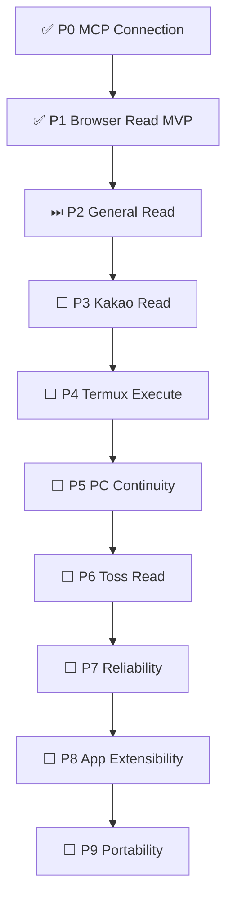

# ClosePaw · Project Dashboard

> **Source of truth:** [PROGRESS.md](../../PROGRESS.md). Last verified update: **2026-10-11 (KST)**. This file is a human-readable snapshot; the GitHub Projects board has separate status fields and **must not be assumed synchronized**.

## At a glance

| Area | Verified position | Evidence / next gate |
| --- | --- | --- |
| Overall roadmap | **2/10 milestones DONE**: P0 and P1; **P2 NEXT**; P3–P9 LATER | [Current progress](../../PROGRESS.md) |
| P0 · MCP Connection | ✅ DONE | Galaxy ChatGPT text/voice → ClosePaw `get_status()` verified |
| P1 · Browser Read MVP | ✅ DONE | [Issue #68](../../issues/68) closed as completed: Galaxy v0.1.37, one screenshot + local Korean OCR; ChatGPT Voice summarized visible Korean article text in **19 seconds** on 2026-10-11 |
| P2 · General Read | ⏭ NEXT | [Issue #69](../../issues/69) open: Chrome + Gemini READ, retaining Samsung regression |
| P7 · Reliability | ⬜ LATER | [Issue #74](../../issues/74) open: reconnect after app restart, Wi-Fi↔5G, reboot; deliberately outside P1 gate |
| Signed release | ✅ v0.1.37 (38) | [Verified signed APK](../../releases/tag/v0.1.37), installed on Galaxy; [PR #80](../../pull/80) |
| GitHub Projects board | ⚠️ Status **not independently verified here** | [ClosePaw Delivery Project #2](https://github.com/users/al-hub/projects/2/views/1). Closing Issue #68 does not prove its Project **Status** field changed. This integration can update repository files/issues, not GitHub Projects v2 item fields. |

## Roadmap

## Project board and synchronization

The previously configured **ClosePaw Delivery Project #2** is a separate GitHub Projects board; the connected GitHub tool can read/change repository issues and files but does not currently expose GitHub Projects v2 project items or custom-field updates. Consequently:

- **P1 Issue #68:** verified `Closed / Completed`. **P1 Projects card Status:** not directly verified and may still show `In Progress`.
- **P2 Issue #69:** verified `Open`. Keep as the next milestone; move the Projects card into the active execution column when beginning P2.
- **P7 Issue #74:** verified `Open`; remains a future reliability milestone, not a P1 blocker.
- For future auto-updates, check the Projects **Workflows** configuration (for example, `Item closed` → `Done`). Do not claim that any automation has been enabled until its actual Project settings or effects are verified.

If Overview, Execution, or Roadmap views exist, keep them consistent with the issue state and this [milestone source of truth](../../PROGRESS.md). The repository has enabled Issues and P0–P9 milestone issues already exist; the old 2026-10-09 pilot statement that Issues are disabled or no Project exists is obsolete.

## Acceptance and handoff rules

- Completion requires real user-facing Galaxy evidence, not merely code, a successful workflow, or an APK install.
- P1 covers **one visible-screen snapshot**, not full-page extraction, URL/tab monitoring or long-running tunnel recovery. The successful user-visible Voice summary took **19 seconds**. Its internal tool request ID was not provided, so no exact trace correlation is claimed.
- Keep separate links for source changes, signed Release, on-device installation, and Voice result. Preserve historical investigation notes in [Issue #68](../../issues/68).
- **Next action: P2 General Read #69** — use the established visible-screen READ approach for Chrome and Gemini, check Galaxy behavior and Voice accuracy.
- Never change signing secrets, Release triggers, or production branches as part of Projects dashboard maintenance.

> **Important:** This documentation update does **not** modify the live GitHub Projects board item Status or enable its Workflows.
